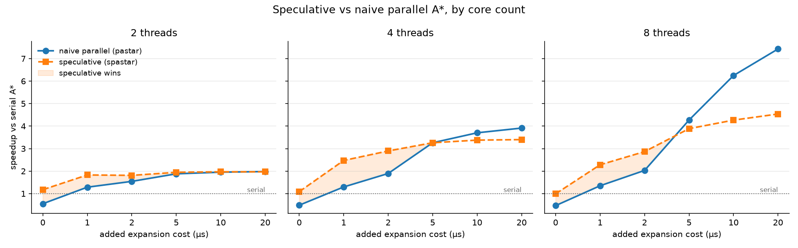
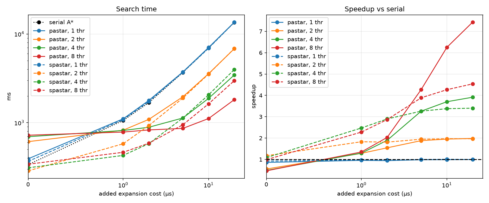
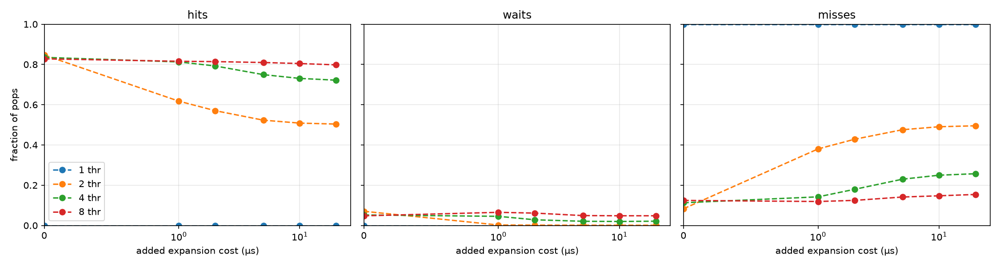
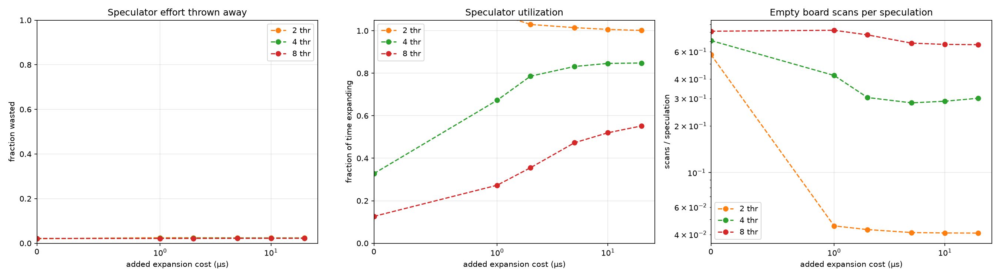
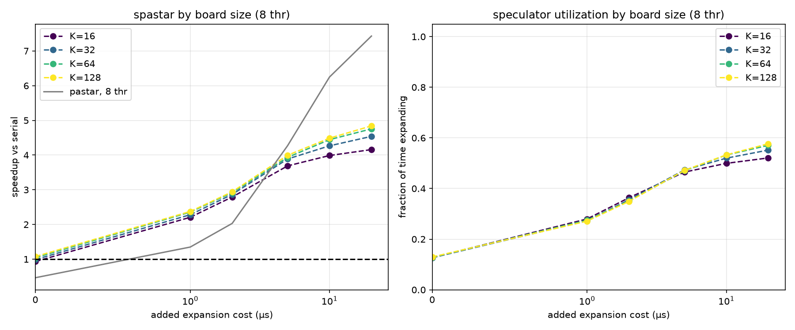

# SPBFS: Speculative Parallel Best-First Search

A C++ implementation and performance study of **speculative parallel A\***: one thread runs ordinary A\* while helper threads expand the nodes it is *about* to need. It's compared against serial A\* and a conventional lock-based parallel A\* across a range of per-node costs.

**Headline result:** when per-node work is cheap (≈1–2 µs), speculative A\* reaches **2.5–3× over serial A\***, a regime where lock-based parallel A\* manages only 1.35–2×. It is the only parallel design here that beats serial A\* at all on the cheapest nodes. Above ~4–5 µs per node, lock-based parallelism wins.

<!-- IMAGE: results/speedup_by_threads.png  (hero figure: one panel per thread count, shaded region = speculative wins) -->


---

## Contents
- [The idea](#the-idea)
- [The three algorithms](#the-three-algorithms)
- [How speculation works](#how-speculation-works)
- [Benchmark methodology](#benchmark-methodology)
- [Results](#results)
- [What the optimization history taught](#what-the-optimization-history-taught)
- [Limitations and future work](#limitations-and-future-work)
- [Building and running](#building-and-running)

---

## The idea

A\* is hard to parallelize because it's inherently ordered: it must always expand the node with the lowest *f = g + h*. The usual approach, many threads popping from a shared, locked open list, works well when expanding a node is expensive, but when expansion is cheap, the threads spend most of their time fighting over the lock.

SPBFS takes a different approach. **One main thread runs completely normal A\***, in exactly the order serial A\* would. Speculator threads look at nodes near the top of the open list and expand them *ahead of time*. When the main thread pops a node, its successors are often already computed, so it only does heap and bookkeeping work.

Because all speculative work is optional, speculation can never make the search wrong. At worst, the main thread does the work itself.

### Why vacuum world?

The test domain is **vacuum world**: a robot on a grid with walls must visit and vacuum every piece of trash. It's simple, its state space grows quickly with the amount of trash, and its expansions are extremely cheap (~0.5 µs), which makes it a stress test for parallel overhead.

Real search problems often have much more expensive nodes: planning heuristics like h^FF or LM-cut, collision checking in motion planning, simulator steps, or model calls in LLM-driven search. An **artificial expansion-cost knob** (a busy-wait added to every expansion) models that whole range, from "nanoseconds" to "tens of microseconds per node."

---

## The three algorithms

| | Description | Coordination |
|---|---|---|
| **`astar`** | Serial A\*. The baseline and the correctness referee. | none |
| **`pastar`** | Naive parallel A\*: N threads share one open list behind a mutex. Each thread pops, expands outside the lock, then re-locks to push children. | one global mutex |
| **`spastar`** | Speculative parallel A\*: 1 main thread + (N−1) speculators. | atomics only, no locks on the hot path |

All three use the same state representation, heuristic, and tie-breaking (lowest *f*, ties broken toward higher *g*). Thread counts are **total cores**, so `spastar` with 4 threads means 1 main thread plus 3 speculators.

---

## How speculation works

<!-- IMAGE (optional): a simple diagram of main thread / board / speculators. Could be hand-drawn. -->

**Node arena.** Every node lives in a `std::deque` that only grows. Nodes never move or get freed during the search, so raw pointers to them stay valid for the whole run, and speculation results can be stored *on the node itself*. Paths are reconstructed through parent pointers.

**The board.** A small fixed array of `std::atomic<SNode*>` slots (size *K*). Only the main thread writes to it. Each time it pushes a new child, it publishes that child into the next slot, wrapping around like a circular buffer.

**Claiming work.** Each node has an atomic state: `IDLE → BUSY → DONE`. Speculators scan the board and claim a node with a compare-and-swap from `IDLE` to `BUSY`, expand it (successors **and** their heuristic values), store the results on the node, then mark it `DONE` with a release store. The CAS guarantees that no node is ever expanded twice.

**The main thread's pop.** When the main thread pops a node, it attempts the same CAS:

| Outcome | Meaning | Main thread does |
|---|---|---|
| **hit** | node is already `DONE` | uses the precomputed successors (free) |
| **wait** | node is `BUSY` (a speculator is mid-expansion) | spins until `DONE` |
| **miss** | its own CAS wins (nobody touched it) | expands the node itself |

The main thread owns the heap, the `best_g` table, and every decision. Speculators only ever read immutable node state and write results to nodes they've claimed, so the shared data structures need no locks.

**Determinism.** Because the main thread processes nodes in exactly serial A\*'s order, `spastar` expands **exactly the same nodes as serial A\*** on every run (648,160 on the benchmark map). Lock-based `pastar` varies slightly from run to run (648,160–648,234).

---

## Benchmark methodology

- **Map:** `maps/path_data/100_100_0.4_50_5` (100×100 grid). About 650k expansions, so ~0.3 s per serial run at cost 0, long enough that thread startup, allocation and teardown don't distort the timing. (An earlier, smaller map finished in ~10 ms, which turned out to be too short to measure 5–10% effects.)
- **Expansion cost:** 0, 1, 2, 5, 10, 20 µs added per expansion, implemented as a busy-wait so the core stays occupied the way real work would. The cost is applied identically in all three algorithms.
- **Threads:** 1, 2, 4, 8. **Board size K:** 16, 32, 64, 128.
- **Metric:** expansions per second, plus speedup relative to serial A\* **from the same run**, which cancels out machine drift (observed at ~5–10% between runs).
- **Correctness referee:** every run's path length must match serial A\* (440 on this map), and expansion counts are checked per algorithm. The plotting script prints both.
- **Instrumentation (spastar):** hits / waits / misses per pop, total speculative expansions, and empty board scans. Checked invariant: `speculations ≥ hits + waits`.
- **Hardware:** Ryzen 7 5800x, 8 core 16 thread, 48GB ddr4 at 2666 MT/s, Arch Linux 7.2.3-arch1-2, clang version 22.1.8, `clang++ -std=c++26 -O3`.

---

## Results

### Speedup over serial A\* (best configuration per algorithm)

| added cost / node | naive parallel (`pastar`) | speculative (`spastar`) | speculative vs naive |
|---|---|---|---|
| 0 µs | 0.55× | **1.19×** | **+116%** |
| 1 µs | 1.35× | **2.47×** | **+83%** |
| 2 µs | 2.03× | **3.01×** | **+48%** |
| 5 µs | **4.27×** | 3.99× | −7% |
| 10 µs | **6.25×** | 4.48× | −28% |
| 20 µs | **7.42×** | 4.83× | −35% |

<!-- IMAGE: images/plot.png  (absolute search time + speedup, all configs) -->


### Reading the results

**Cheap nodes (0–2 µs): speculation wins.** The expansion is so fast that `pastar`'s threads spend most of their time waiting on the global lock. At cost 0 it's *slower than serial*. `spastar` never takes a lock on the hot path, so its main thread just runs A\* while the speculators remove the expansion work from under it.

**Expensive nodes (≥5 µs): lock-based wins.** Once expansion dominates, the lock is a small fraction of each thread's time, and *every* `pastar` thread does useful work. In `spastar`, one thread still does all the heap and bookkeeping work serially, which caps how fast nodes can be consumed.

**Why spastar plateaus.** At high cost, speculators are idle about half the time, even though less than 3% of their work is wasted. A node's children only become available for speculation after the main thread pops that node. Because tie-breaking favors depth, the next pop is often a child of the current one, which was *just* published, so the main thread waits on a speculator that has barely started. Speculators can only stay about one generation ahead of the main thread.

<!-- IMAGE: images/pop_outcomes.png  (hits / waits / misses by cost and thread count) -->


<!-- IMAGE: images/speculators.png  (wasted speculation ≈ 2%, utilization, empty scans) -->


### Board size

*K* barely matters at 2 threads. At 8 threads, larger boards help consistently (K=128 best), because more speculators need more claimable work.

<!-- IMAGE: images/board_size.png -->


### Raw throughput

The full expansions-per-second table for every configuration is written to `results/throughput.txt` by `plot.py`.

---

## What the optimization history taught

The project went through a series of measured changes (see `results.md` for each run's raw tables). The lessons that generalize:

1. **Representation beat parallelism.** Replacing the state's `unordered_set<Position>` of trash with a `uint64_t` bitmask made a state 16 trivially-copyable bytes. That made **serial A\* ~4× faster**, removed `spastar`'s single-thread overhead (27% → ~8%), and roughly doubled speculation's advantage over the lock-based design. The profiler (`perf`) showed allocation and hashing dominating both designs; no amount of threading would have fixed that.

2. **What's under the lock matters more than the lock.** Replacing the `from` parent map with parent pointers removed hashing and allocation from inside `pastar`'s critical section and made it up to ~2.6× faster. The same change barely affected `spastar`, which never held that work under a lock.

3. **Cache-line traffic is a real cost.** Publishing the top-K heap entries to the board on every expansion rewrote up to K atomic slots that every speculator was reading, which collapsed low-cost throughput as K × threads grew. Skipping stores for unchanged slots fixed most of it. The simplest scheme, circular publishing of new children, ultimately beat both.

4. **Make sure the benchmark can see the effect.** Once runs dropped to ~10 ms, fixed costs drowned out real improvements. Moving to a ~650k-expansion map, normalizing to same-run serial, and checking invariants on every run made 5–10% differences trustworthy.

5. **Measure; don't trust the first explanation.** Several plausible stories (misses causing the plateau, false sharing, board starvation) were tested and ruled out by instrumentation before landing on the dependency-chain explanation above.

Also tested: `alignas(64)` nodes and padded counters (within noise; false sharing was not the bottleneck), and computing heuristics speculatively (neutral here because vacuum world's heuristic costs nanoseconds; expected to matter when *h* is expensive).

<!-- NOTE: if git history shows the early circular-board code published the parent instead of the child, note here that the Run 1–3 "smart fill predicts better" result was likely an artifact. -->

---

## Limitations and future work

- **One domain.** Vacuum world has cheap nodes and many duplicate states. Domains with expensive heuristics or few duplicates may behave differently.
- **Synthetic cost.** The expansion-cost knob models expensive nodes but isn't a real workload. Next step: a **heuristic-cost knob**, to show the benefit of computing *h* speculatively.
- **The plateau.** Letting speculators go *a generation deeper* (expanding the children of nodes they just finished) would attack the dependency chain directly.
- **Single machine.** Results are from one CPU. Scaling and crossover points will shift on other hardware.

---

## Building and running

```bash
make                                   # builds bin/spbfs with -O3
./bin/spbfs <algo> <cost_us> <threads> <board_k> < <map>

# examples
./bin/spbfs astar   0 1 0   < maps/path_data/100_100_0.4_50_5
./bin/spbfs spastar 2 8 128 < maps/path_data/100_100_0.4_50_5
```

`algo` is one of `astar`, `pastar`, `spastar`. Each run prints one CSV line:

```
algo,cost,threads,board_k,us,expanded,generated,hits,waits,misses,speculations,empty-scans,path
```

Full sweep and plots:

```bash
./sweep.sh        # rebuilds, then runs every algo × cost × threads × K into results/all.csv
python3 plot.py   # sanity checks + figures + results/throughput.txt
```

### Layout

```
src/
  main.cpp       argument parsing, timing, CSV output
  vw_map.hpp     vacuum world: map, bitmask state, successors, heuristic, parser
  common.hpp     shared node types, stats, spin_for
  astar.hpp      serial A*
  pastar.hpp     lock-based parallel A*
  spastar.hpp    speculative parallel A*
maps/            test maps
results/         CSVs, figures
plot.py          analysis and plotting
sweep.sh         benchmark driver
results.md       per-run notes
```